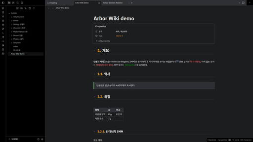

# Wikibaum

A Korean-wiki-style theme for Obsidian, with light and dark modes.

Visual direction inspired by Namu Wiki. This project is not affiliated with or endorsed by Namu Wiki.

## Features

- Brand-colored tab bar above the editor
- Automatic section numbers in front of headings (`1.`, `1.1.`, `1.1.1.`) in Reading view
- Underlined headings, plain links (blue in light mode, orange in dark mode), red unresolved links, green external links
- Dashed quote box with a green side bar
- Full-grid tables and a boxed properties area
- Heading fold arrows that stay visible, in front of the section number
- Graph view on a panel, with quiet grey notes and the open note in the link color
- Wiki-style boxes for Bases panels docked in the right sidebar (see below)
- Korean-first font stack (Pretendard, Noto Sans KR, Apple SD Gothic Neo, Malgun Gothic). Fonts are not bundled; install Pretendard for the intended look.

## Options

With the [Style Settings](https://github.com/mgmeyers/obsidian-style-settings) plugin you can:

- hide section numbers, or start numbering at H2 instead of H1
- show section numbers in Live Preview (experimental)
- remove the colored tab bar or heading underlines
- show heading fold arrows only on hover
- turn off the sidebar boxes for Bases panels
- pick the graph colors: Quiet (default), Wiki links (every note in the link color) or Obsidian default
- change the brand, link, unresolved-link and external-link colors

## Sidebar boxes (Recent changes, Most linked)

A theme cannot build lists of notes by itself, so the lists come from the Bases core plugin and the theme gives them the wiki look. The [`examples`](examples) folder has two Bases files:

- `최근 변경.base` (Recent changes): the 10 most recently modified notes, with relative times
- `많이 참조된 문서.base` (Most linked): the 10 notes with the most backlinks

To use them:

1. Make sure the Bases core plugin is on, then copy the files anywhere into your vault.
2. Open each file and drag its tab into the right sidebar. Drag one below the other to stack them.

Any Bases list view docked in the right sidebar gets the box style: the view name becomes the box title, the note name sits on the left and the value on the right. Bases opened in the main area keep their normal look. Relative times follow the app language.

## Known limitations

Section numbers are drawn with CSS counters. Obsidian renders only part of a long note at a time, so numbers can be wrong when headings far above the screen are not rendered. For numbers that are always correct, use a plugin that writes the numbers into the note text.

## 한국어 안내

나무위키풍 Obsidian 테마입니다. 읽기 모드에서 제목 앞에 `1.`, `1.1.` 형식의 번호가 자동으로 붙고, 링크·인용·표가 위키 형식으로 표시됩니다. Style Settings 플러그인으로 번호 시작 단계(H1/H2), 상단 색 막대, 색상을 조정할 수 있습니다. `examples` 폴더의 `.base` 파일 두 개(최근 변경, 많이 참조된 문서)를 볼트에 복사해 오른쪽 사이드바에 끌어다 두면 위키 사이드바 같은 상자로 표시됩니다. 나무위키와 무관한 비공식 테마입니다.

## License

MIT
